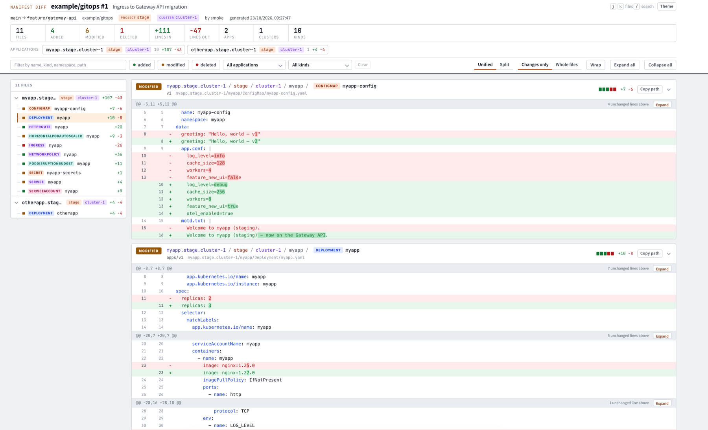

<p align="center">
  
</p>

<p align="center">
  <a href="https://github.com/kazysgurskas/argocd-diff/actions/workflows/ci.yaml"></a>
  <a href="https://goreportcard.com/report/github.com/kazysgurskas/argocd-diff"></a>
  <a href="https://pkg.go.dev/github.com/kazysgurskas/argocd-diff"></a>
  <a href="https://github.com/kazysgurskas/argocd-diff/releases/latest"></a>
  
  <a href="LICENSE"></a>
</p>

# argocd-diff

argocd-diff renders ArgoCD Applications without an ArgoCD instance and shows
what a pull request changes in the Kubernetes manifests they produce. It needs
no ArgoCD server, no cluster and no kubeconfig. It reads the Application
resources as YAML from a checkout of the GitOps repository, pulls and
templates their Helm charts with the Helm SDK, reads their directory sources
as they are, and writes the manifests the way ArgoCD's repo server would, with
Secret values redacted. The only network it uses is to the chart repositories
the Applications name, and pulled charts are cached between runs.

Given the base and head checkouts of a pull request, it renders both and
compares them into a self-contained HTML report and a Markdown summary for a
pull request comment. Where `argocd app diff` asks a running ArgoCD how the
desired state differs from the cluster, argocd-diff asks nothing and shows how
a change to git moves the desired state. That makes it usable in CI on every
pull request, for repositories whose ArgoCD is not reachable from CI, and for
the rendered manifests pattern, where the rendered tree is what gets reviewed
and committed.



Supported sources are Helm charts from HTTP and OCI repositories and
directories of plain manifests, in single-source and multi-source
Applications. Private chart registries work the way they do for `helm pull`:
log in with `helm registry login` or a Docker credential helper first. It was
called argocd-hydrate through the 0.4 releases.

## Install

Download the archive for your platform from the
[releases page](https://github.com/kazysgurskas/argocd-diff/releases),
verify it against `checksums.txt`, and put `argocd-diff` on your `PATH`. Or
build it with Go:

```bash
go install github.com/kazysgurskas/argocd-diff/cmd/argocd-diff@latest
```

A container image is published to GitHub Container Registry with every
release, as `ghcr.io/kazysgurskas/argocd-diff:<version>-amd64` and
`-arm64`:

```bash
docker run --rm ghcr.io/kazysgurskas/argocd-diff:1.0.0-amd64 --version
```

In GitHub Actions, use this repository as an action; see
[GitHub Action](#github-action).

## Usage

Check out the base of the pull request into `base/` and its head into
`head/`, render the ArgoCD Application resources of each into
`applications.yaml` (for example with `helm template` of an app-of-apps
chart), and run:

```bash
argocd-diff --summary diff.md --pr-title "$PR_TITLE" --author "$AUTHOR"
```

That renders both checkouts and writes the report to `diff.html` and the
summary to `diff.md`. Source paths in the Applications (`path:`,
`$values/…`) are resolved against the checkout they belong to. The flags
change the paths: `--base`, `--head` and `--applications` for the inputs,
`--report` and `--summary` for the outputs. `--rendered-dir` keeps the
rendered manifests of both sides, as `base/` and `head/` under it, for other
tools such as kubeconform to scan; without it they go to a temporary
directory. Charts are rendered for `--kube-version`, since there is no
cluster to ask; a chart whose `kubeVersion` constraint excludes it fails with
a message that says so. Charts are pulled once into `--charts-dir` and reused
on later runs, so cache that directory in CI.

```console
$ argocd-diff --help
Render the ArgoCD Applications of two checkouts of a GitOps repository and
show what changed in the Kubernetes manifests they produce, as a
self-contained HTML report and a Markdown summary for a pull request comment.
No ArgoCD instance or cluster is needed.

By default the checkouts are ./base and ./head, each holding its Application
resources as applications.yaml; source paths in the Applications are resolved
against their checkout. Pass --no-hydrate to diff two trees that
"argocd-diff hydrate" rendered earlier.

Inside GitHub Actions the report header is filled from GITHUB_REPOSITORY,
GITHUB_BASE_REF, GITHUB_HEAD_REF and GITHUB_REF; pass --pr-title and --author
from the event.

Usage:
  argocd-diff [flags]
  argocd-diff [command]

Examples:
  # The pull request's base is checked out in base/, its head in head/, and
  # the Application resources were rendered into applications.yaml in each
  argocd-diff --summary diff.md --pr-title "$PR_TITLE" --author "$AUTHOR"

  # Explicit paths, keeping the rendered manifests for other tools to scan
  argocd-diff --base base-checkout --head head-checkout --applications manifests/applications.yaml \
      --rendered-dir rendered --report manifest-diff.html --summary manifest-diff.md

  # Two trees rendered earlier with "argocd-diff hydrate"
  argocd-diff --no-hydrate --base base-manifests --head head-manifests

Available Commands:
  completion  Generate the autocompletion script for the specified shell
  help        Help about any command
  hydrate     Render ArgoCD applications into Kubernetes manifests

Flags:
      --base string           Base checkout of the GitOps repository: a directory or a .zip of one (default "base")
      --head string           Head checkout of the GitOps repository: a directory or a .zip of one (default "head")
      --applications string   ArgoCD Application file inside each checkout, as "helm template" of an app-of-apps chart writes it (default "applications.yaml")
      --no-hydrate            Base and head are already rendered manifest trees, as "argocd-diff hydrate" writes them; diff them as they are
      --kube-version string   Kubernetes version to render Helm charts for (default "1.35.6")
      --charts-dir string     Directory pulled Helm charts are kept in between runs (default "cache")
      --rendered-dir string   Keep the rendered manifests of both sides here, as base/ and head/, for other tools to scan (default: a temporary directory)
      --report string         HTML report to write (default "diff.html")
      --summary string        Markdown summary to write, for a pull request comment (default: none)
      --context int           Unchanged lines the report keeps around each change (default 3)
      --full-text-limit int   Largest modified file, in lines, whose whole text the report embeds so context can be expanded (-1: never) (default 2000)
      --title string          Title of the report (default: "<repo> #<pr-number>", or the two paths)
      --repo string           Repository as owner/name, shown in the report header (default: $GITHUB_REPOSITORY)
      --pr-number int         Pull request number, shown in the report header (default: from $GITHUB_REF or $GITHUB_PR_NUMBER)
      --pr-title string       Pull request title, shown in the report header
      --pr-url string         Link from the report header to the pull request (default: github.com/<repo>/pull/<pr-number>)
      --base-ref string       Base branch, shown in the report header (default: $GITHUB_BASE_REF)
      --head-ref string       Head branch, shown in the report header (default: $GITHUB_HEAD_REF)
      --author string         Pull request author, shown in the report header
  -h, --help                  help for argocd-diff
  -v, --version               version for argocd-diff

Use "argocd-diff [command] --help" for more information about a command.
```

The 1.0 names `--output`, `--rendered`, `--base-applications` and
`--head-applications` still work and print a deprecation warning.

## The report

The report groups files by application and offers a unified or split view,
context expansion, filters by status, application, project, cluster and kind,
intra-line change highlighting, dark mode and keyboard navigation. Only
`.yaml`/`.yml` files take part.

Its header names the repository, the pull request, the branches and the
author. Inside GitHub Actions, `--repo`, `--base-ref` and `--head-ref` are
read from `GITHUB_REPOSITORY`, `GITHUB_BASE_REF` and `GITHUB_HEAD_REF`, and
`--pr-number` from `GITHUB_REF` on `pull_request` events (or from
`GITHUB_PR_NUMBER` if your workflow exports it), so only `--pr-title` and
`--author` are worth passing from the event. `--title` replaces the generated
title, and `--pr-url` the generated link to the pull request.

Each file is labelled with the ArgoCD Application it was rendered for, the
first path segment, which is the Application's `metadata.name`, and with that
Application's `spec.project` and `spec.destination.name`, read from the
Applications just rendered. `--context` sets the unchanged lines kept around
a change (default 3) and `--full-text-limit` the largest modified file whose
whole text is embedded so context can be expanded in the viewer (default
2000 lines).

The report embeds the diff as JSON and renders it in the browser, so a page
with hundreds of changed manifests stays small and only draws what is on
screen. Secrets are already redacted by the hydrate step.

`--summary <file>` also writes a Markdown summary for a pull request comment:
a totals line ("11 manifests changed: 4 added, 6 modified, 1 deleted") and a
table with one row per application, project and cluster, collapsed when
it has more than eight rows. A pull request that renders to no change says so
in one line.

## Diffing trees rendered earlier

With `--no-hydrate`, `--base` and `--head` are trees that
`argocd-diff hydrate` wrote earlier, and they are diffed as they are:

```bash
argocd-diff --no-hydrate --base base-manifests --head head-manifests
```

The project and cluster labels then come from an `applications.yaml` at the
root of each tree, when there is one; without it, files still group by
Application and only those labels stay empty.

## Rendering on its own

`argocd-diff hydrate` renders one checkout into a tree of manifests, for the
rendered-manifests pattern, for review tools that read plain manifests, or
for diffing later with `--no-hydrate`. Run it from the checkout, since source
paths are relative to the working directory.

```console
$ argocd-diff hydrate --help
Render the ArgoCD Applications of one checkout into the Kubernetes manifests
they would deploy, without an ArgoCD instance. Helm chart sources are pulled
and templated, directory sources are read as they are, and Secret values are
redacted. Source paths in the Applications are relative to the working
directory, so run it from the checkout. Each application is written to
<rendered-dir>/<application>/<namespace>/<Kind>/<name>.yaml, or
<rendered-dir>/<application>/<Kind>/<name>.yaml for a cluster-scoped object.

Usage:
  argocd-diff hydrate [flags]

Examples:
  argocd-diff hydrate
  argocd-diff hydrate --applications manifests/applications.yaml --rendered-dir rendered --kube-version 1.35.6

Flags:
      --applications string   ArgoCD Application file to render (default "applications.yaml")
      --rendered-dir string   Directory to write the rendered manifests to (default "rendered")
      --kube-version string   Kubernetes version to render Helm charts for (default "1.35.6")
      --charts-dir string     Directory pulled Helm charts are kept in between runs (default "cache")
  -h, --help                  help for hydrate
```

Progress is logged to stderr; an error is reported once and exits with
status 1.

## GitHub Action

This repository is also a GitHub Action; it installs the release whose tag it
is used with:

```yaml
- uses: actions/checkout@v4
  with:
    ref: ${{ github.event.pull_request.base.sha }}
    path: base
- uses: actions/checkout@v4
  with:
    path: head
- run: |
    for side in base head; do
      helm template "$side" > "$side/applications.yaml"
    done
- uses: kazysgurskas/argocd-diff@v2.0.0
- run: argocd-diff --summary diff.md --pr-title "$PR_TITLE" --author "$AUTHOR"
  env:
    PR_TITLE: ${{ github.event.pull_request.title }}
    AUTHOR: ${{ github.event.pull_request.user.login }}
```

When the action is pinned by commit SHA, name the release to install:

```yaml
- uses: kazysgurskas/argocd-diff@<sha> # v2.0.0
  with:
    version: v2.0.0
```

After that, publish `diff.html` where reviewers can open it, as a workflow
artifact or elsewhere, and post `diff.md` as a comment. None of it needs
credentials for ArgoCD or the clusters, only for private chart registries.
The workflow in
[argocd-gitops-example](https://github.com/kazysgurskas/argocd-gitops-example)
is a complete example.

## Smoke test

`make smoke` runs the default form on the example under
[`test/smoke/`](test/smoke/), two checkouts of a small GitOps repository, and
writes `test/smoke/out/example/diff.html`. See
[test/smoke/README.md](test/smoke/README.md) for using it with your own
scenarios.

## Docker

```bash
docker build -t argocd-diff .
docker run -v $(pwd):/workspace -w /workspace argocd-diff --summary diff.md
```

## License

This project is licensed under the [Apache License](LICENSE).

## Contributing

Contributions are welcome! Please feel free to submit a Pull Request.
